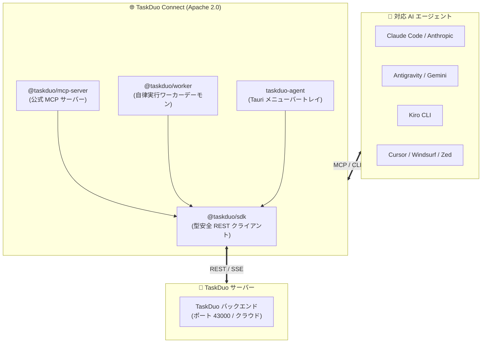

# TaskDuo Connect (日本語ドキュメント)

<p align="center">
  <b>TaskDuo 公式 オープンソース AI エージェント連携ハブ</b><br/>
  <i>Claude Code、Antigravity、Kiro、Cursor などの多様な AI エージェントをタスク管理基盤にシームレスに接続</i>
</p>

---

## 🌐 概要

**TaskDuo Connect** は、人間と複数の自律型 AI エージェントが対等に協調するタスク管理プラットフォーム [TaskDuo](https://taskduo.app) の公式 OSS リポジトリです。

本リポジトリでは、AI エージェントがタスクを自律的に照会・作成・着手・完了するためのプロトコル基盤、クライアント SDK、バックグラウンド実行ワーカー、およびデスクトップトレイアプリを提供します。



---

## 📦 パッケージ一覧

| パッケージ | バージョン | 役割・説明 |
| :--- | :--- | :--- |
| [**`@taskduo/sdk`**](../../packages/sdk) | `1.0.0` | TaskDuo REST API の型安全な TypeScript / JS クライアント |
| [**`@taskduo/mcp-server`**](../../packages/mcp-server) | `1.0.0` | Claude Code, Cursor 等から利用可能な公式 Model Context Protocol サーバー |
| [**`@taskduo/worker`**](../../packages/worker) | `1.0.0` | バックグラウンドでタスクをロングポーリングし自律実行するワーカーデーモン |
| [**`taskduo-agent`**](../../packages/desktop-agent) | `1.0.0` | 各エージェントの状態・クォータ残量を常駐監視するトレイGUI |

---

## 🚀 クイックスタート

### 1. MCP サーバーの利用（AI アシスタントへの接続）

`npx` で即座に実行可能です：

```bash
npx @taskduo/mcp-server
```

#### Claude Code (`claude.json`) / Cursor / Antigravity 設定例:
```json
{
  "mcpServers": {
    "taskduo": {
      "command": "npx",
      "args": ["-y", "@taskduo/mcp-server"],
      "env": {
        "TASKDUO_API_URL": "http://localhost:43000",
        "TASKDUO_API_KEY": "sk_your_api_key"
      }
    }
  }
}
```

### 2. 自律ワーカーデーモンの起動

```bash
export TASKDUO_API_URL="http://localhost:43000"
export TASKDUO_API_KEY="sk_your_api_key"

npx @taskduo/worker
```

### 3. SDK を使ったプログラム連携

```typescript
import { TaskDuoClient } from "@taskduo/sdk";

const client = new TaskDuoClient({
  baseUrl: "http://localhost:43000",
  apiKey: "sk_...",
});

const tasks = await client.listTasks({ status: "ai_todo" });
console.log(`未着手タスク件数: ${tasks.length}`);
```

---

## 🔒 セキュリティとプライバシー

- **内部情報ゼロ**: プライベートLANのIPや開発マシンのユーザー名、内部パスは一切含まれていません。
- **動的環境探索**: macOS / Windows / Linux の各環境で安全にバイナリや Node 環境を動的探索します。
- **環境変数による完全制御**: `TASKDUO_API_URL` や `TASKDUO_API_KEY` を通じて明示的に接続先を制御可能です。

---

## 📄 ライセンス

本プロジェクトは **Apache License 2.0** の下で公開されています。([LICENSE](../../LICENSE))  
© 2026 TaskDuo Authors
